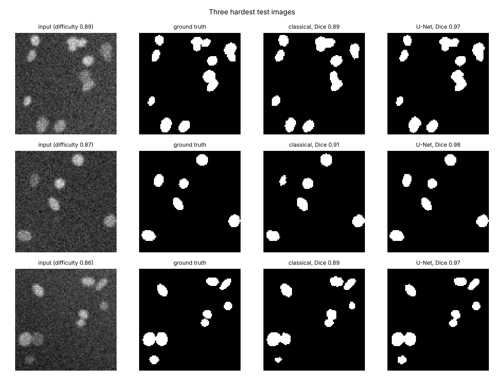

# Microscopy Cell Segmentation: Classical Pipeline vs U-Net

Counting and outlining cells in fluorescence microscopy images is a daily task in biology labs. This project compares two ways of doing it:

1. **Classical image processing:** Gaussian smoothing, white top-hat background correction, Otsu thresholding, hole filling, then a distance-transform watershed to split touching cells.
2. **A small U-Net** (about 117 k parameters) trained with BCE + Dice loss.

Both are evaluated on the same test images, and the comparison is split by image difficulty (noise level and uneven illumination).

## Data

Real annotated microscopy data is slow to obtain, so the experiment uses **synthetic fluorescence images with exact ground truth** (`mcs/synth.py`). Each 96×96 image has elliptical cells of varying size, brightness and orientation, some touching, plus:

* uneven illumination (a brightness gradient across the field),
* optical blur,
* Poisson shot noise and Gaussian read noise.

A *difficulty* value between 0.2 and 0.9 controls the noise and illumination. Training uses 400 images; testing uses 150 new images (about 9.5 cells each).

To use real data (for example the Data Science Bowl 2018 nuclei set or a BBBC dataset), put images and label masks with matching file names in two folders and load them with `mcs.io.load_folder` (see below).

## Results (150 test images)

| Method | Images | Dice | IoU | Mean abs. count error |
|---|---|---|---|---|
| Classical (top-hat + Otsu + watershed) | easy (66) | 0.927 | 0.864 | 0.49 |
| | hard (84) | 0.918 | 0.850 | 0.58 |
| | **all** | **0.922** | **0.856** | **0.54** |
| U-Net | easy (66) | 0.986 | 0.973 | 0.33 |
| | hard (84) | 0.977 | 0.956 | 0.52 |
| | **all** | **0.981** | **0.963** | **0.44** |

"Easy" means difficulty < 0.55. Count error is the absolute difference between the number of detected and true cells per image; both methods use the same watershed step to split the binary mask into instances.



### What I learned

* **The U-Net wins clearly on pixel accuracy** (Dice 0.981 vs 0.922). The classical masks are blobby at the edges and lose faint cells in noisy images.
* **The classical pipeline is a strong, zero-training baseline.** A Dice of 0.92 with no labelled data at all is useful when a lab has no annotations yet.
* **Counting is harder than outlining.** Even with near-perfect masks, the U-Net still miscounts about 0.5 cells per hard image, because touching cells must be split by the watershed. Cell counts need an instance-aware model (e.g. StarDist or Cellpose) rather than better binary masks.
* **Synthetic data has limits.** Real images have textures, debris and out-of-focus cells that this generator does not produce, so these numbers are an upper bound for what to expect on real slides.

## Reproduce

```bash
pip install -r requirements.txt
python scripts/run_experiment.py   # about 70 s on a 2-core CPU
pytest -q
```

Outputs: `results/results.json` and `results/examples.png`.

## Use your own images

```python
from mcs.io import load_folder
from mcs import classical, unet
from mcs.metrics import dice

X, L = load_folder("data/images", "data/masks", size=96)
model, _ = unet.train(X[:80], L[:80] > 0, epochs=30)
pred = unet.predict(model, X[80:])
print(sum(dice(p, l > 0) for p, l in zip(pred, L[80:])) / len(pred))
```

## Layout

```
mcs/synth.py       synthetic fluorescence images with ground-truth labels
mcs/classical.py   top-hat + Otsu + watershed baseline
mcs/unet.py        U-Net, Dice loss, training loop with flip augmentation
mcs/metrics.py     Dice, IoU, count error
mcs/io.py          loader for real image/mask folders
scripts/run_experiment.py
tests/
```

## Next steps

* Train and test on a real nuclei dataset and measure the synthetic-to-real gap.
* Replace the watershed with an instance head (distance map or star-convex polygons) to cut the count error.
* Pre-train on synthetic data, fine-tune on a few real images, and plot accuracy against the number of real labels.

## References

* O. Ronneberger, P. Fischer, T. Brox. *U-Net: Convolutional Networks for Biomedical Image Segmentation.* MICCAI 2015.
* N. Otsu. *A Threshold Selection Method from Gray-Level Histograms.* IEEE Trans. SMC, 1979.
* U. Schmidt, M. Weigert, C. Broaddus, G. Myers. *Cell Detection with Star-Convex Polygons.* MICCAI 2018.
* C. Stringer, T. Wang, M. Michaelos, M. Pachitariu. *Cellpose: a generalist algorithm for cellular segmentation.* Nature Methods, 2021.

## Author

**Kazi Rezwan Rashid**, Lecturer in Computer Science and Engineering, Siddheswari University College, Dhaka.
[LinkedIn](https://www.linkedin.com/in/rezwan.rashid) · [Website](https://rezwanrashid.pythonanywhere.com/)

Licensed under the MIT License.
